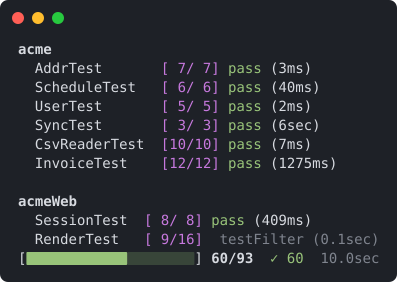

# Jig

A better Fantom test runner.

Jig wraps `fant` with output you can scan: results grouped by pod and test
class, a live status bar pinned to the bottom of the terminal, and failures
printed with only the output and stack frames that matter.



## Install

Install from [Eggbox](https://eggbox.fantomfactory.org) with `fanr`:

```sh
fanr install jig
```

If your `etc/fanr/config.props` doesn't default to Eggbox, pass the repo:

```sh
fanr install -r https://eggbox.fantomfactory.org/fanr/ jig
```

This installs into your Fantom home, so `fan jig` works from any workenv.

To build from source instead, copy the pod into your Fantom home
(`fan -version` prints the `fan.home` path):

```sh
fan src/jig/build.fan
cp lib/fan/jig.pod <fan.home>/lib/fan/
```

### Run as `jig`

On macOS or Linux, save this script as `jig` in a directory on your `PATH`
(for example `/usr/local/bin/jig`) and make it executable with
`chmod +x`:

```sh
#!/bin/sh
exec fan jig "$@"
```

Now `jig acme` works the same as `fan jig acme`.

## Usage

```
jig [options] <targets>*
```

Targets use the same syntax as `fant`:

```sh
fan jig acme                      # all tests in pod
fan jig acme::FooTest             # all tests in a type
fan jig acme::FooTest.testBar     # a single test method
fan jig -w                        # all pods in workDir lib/fan/
```

Options:

| Option                   | Description                                         |
|--------------------------|-----------------------------------------------------|
| `-w`, `--work`           | Test all pods in your workenv's `lib/fan/`          |
| `-q`, `--quiet`          | Only print failures, status bar, and summary        |
| `-es`                    | Test new ECMA JavaScript environment (passthrough)  |
| `-js`                    | Test legacy JavaScript environment (passthrough)    |

Exit code is `0` if all tests pass, `1` otherwise.

### `-w` vs `fant -all`

`fant -all` runs every pod the env can resolve, including Fantom core and
any `fan.props` path dependencies. `jig -w` only runs pods built into your
workenv's own `lib/fan/`, and refuses to run outside a workenv.

## Output

**Default** prints one line per test class, grouped by pod:

  - `[passed/total]` counts, with columns aligned across all pods
  - `pass` / `fail` with elapsed time for the class (`4900ms` under 5sec,
    `7.2sec` under a minute, then `1min 2sec`)
  - Failures indented under their class: `FAIL: <method>`, anything the test
    printed (prefixed with `|`), and the stack trace with test harness frames
    (reflection, `TestRunner`, `verify` internals) removed
  - A summary line after each pod when the run covers more than one pod

Output from passing tests is hidden.

**Quiet** (`-q`) prints failures as they happen with full qualified names,
and nothing for passing tests.

Both modes end with a one-line summary plus one line per failure showing how
many tests in that class failed.

**Status bar.** When stdout is a terminal, a status bar on the bottom line
shows percent complete, tests run, pass/fail counts, total elapsed time,
and the current pod with its test progress, so you know where you are after
the pod header scrolls away. In default mode the class currently running
sits above it with live counts and a timer for the running method. Colors and the status bar are disabled when output is
piped, `CI` is set, or `TERM=dumb`.

## Platform support

Jig is built for macOS and Linux terminals. It runs on Windows, but the
terminal output has rough edges:

  - **Colors and status bar.** Jig uses ANSI escape codes, which Windows
    Terminal supports but the legacy console does not. Use Windows Terminal,
    or set `TERM=dumb` to get plain output.
  - **Symbols.** `✓ ✗ █ ░` need a UTF-8 console. Run `chcp 65001` first if
    they show as garbled characters.
  - **Terminal width.** Width detection uses `stty`, which Windows lacks, so
    jig assumes 80 columns. Set `COLUMNS` to your window width if long lines
    wrap.

## Build scripts

`BuildPod` runs tests with `fant` in its `test` target, which `full` also
calls. Override `test` to use jig instead:

```fantom
class Build : BuildPod
{
  ...

  @Target { help = "Run the pod unit tests via jig" }
  override Void test()
  {
    fan := devHomeDir + (Env.cur.os == "win32" ? `bin/fan.bat` : `bin/fan`)
    Exec(this, [fan.osPath, "jig", podName]).run
  }
}
```

Failing tests fail the build. For a `BuildGroup`, override `full` to clean
and compile every pod first, then test them all in a single jig run:

```fantom
class Build : BuildGroup
{
  ...

  @Target { help = "Clean and compile all pods, then test all via jig" }
  Void full()
  {
    runOnChildren("clean")
    runOnChildren("compile")
    fan := devHomeDir + (Env.cur.os == "win32" ? `bin/fan.bat` : `bin/fan`)
    Exec(this, [fan.osPath, "jig"].addAll(podNames(this))).run
  }

  ** Pod names of all BuildPod scripts in this group (recursive)
  private Str[] podNames(BuildScript s)
  {
    if (s is BuildPod) return [((BuildPod)s).podName]
    if (s is BuildGroup) return ((BuildGroup)s).children.map |c| { podNames(c) }.flatten
    return Str[,]
  }
}
```

`Exec` captures jig's output, so in build scripts jig prints plain
output without colors or the status bar.

## How it works

Jig resolves targets up front (so typos fail fast and the status bar knows
the total), spawns a single `fant` process, and parses its output as tests
run.
