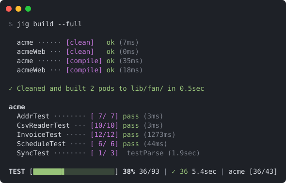
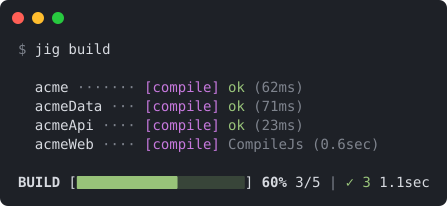
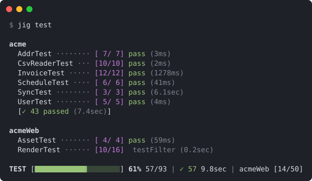

# Jig

A better Fantom build and test tool.



Jig wraps `fan build.fan` and `fant` with output you can scan: a line per
pod or test class as each one finishes, a live status bar pinned to the
bottom of the terminal, and errors and failures collected at the end with
only the lines that matter.

```sh
jig build       # compile every pod under your root build script
jig test        # test every pod in your workenv
jig build -f    # clean, compile, then test
```

## Install

Install from [Eggbox](https://eggbox.fantomfactory.org) with `fanr`:

```sh
fanr install jig
```

If your `etc/fanr/config.props` doesn't default to Eggbox, pass the repo:

```sh
fanr install -r https://eggbox.fantomfactory.org/fanr/ jig
```

Run this from outside any workenv (a directory with no `fan.props` above
it). `fanr` installs into the current env's `lib/fan/`, so outside a workenv
jig lands in your Fantom home and `fan jig` works from any workenv.

To build from source instead, copy the pod into your Fantom home
(`fan -version` prints the `fan.home` path):

```sh
fan src/jig/build.fan
cp lib/fan/jig.pod <fan.home>/lib/fan/
```

### Run as `jig`

On macOS or Linux, save this script as `jig` in the `bin/` directory of the
Fantom install you want it to use, next to `fan` and `fant` (`fan -version`
prints the `fan.home` path), and make it executable with `chmod +x`:

```sh
#!/bin/sh
. "${0%/*}/fanlaunch"
fanlaunch Fan jig "$@"
```

Now `jig test acme` works the same as `fan jig test acme`. Like `fant` and
`fanr`, it runs with the Fantom install it lives in, not whichever `fan` is first on
your `PATH`. Don't symlink it elsewhere, since it finds `fanlaunch` next to
itself.

## Build



```
jig build [<pod> | <file.fan>]* [options]
```

```sh
jig build                         # ./build.fan, else <workDir>/src/build.fan
jig build acme                    # pod acme under the root build script or src/
jig build src/acme/build.fan      # a build script by path
jig build -c                      # clean only
jig build -f                      # clean, compile, then test
jig build -t dist                 # run another build script target
```

A pod name is looked up under the root build script first. That script
depends on where you run jig, so it may not include the pod: in a
directory with its own `build.fan` only the pods under it are seen, and
in one without, such as a repo root, `<workDir>/src/build.fan` may belong
to another repo. If the pod isn't found there, jig searches `src/` of the
current repo, the nearest parent with `.git`, for a directory with that
name whose `build.fan` builds that pod, so `jig build <pod>` works from
anywhere in the repo.

A `BuildGroup` builds all of its children, including nested groups.
`jig build` compiles by default; `-c`, `-f`, and `-t` each pick what runs
instead, so use only one.

| Option                   | Description                                         |
|--------------------------|-----------------------------------------------------|
| `-c`, `--clean`          | Clean only, without compiling                       |
| `-f`, `--full`           | Clean and compile, then test every built pod that has tests; tests are skipped if any pod fails to compile |
| `-t`, `--target <name>`  | Run this build script target instead of compile     |
| `-q`, `--quiet`          | Only print errors, status bar, and summary          |

**Output.** One line per pod and target as each finishes, with `ok` /
`fail` and elapsed time. A group runs each target across all of its pods
before the next, so `-f` shows every `[clean]` row, then every `[compile]`
row. The pod being built sits above the status bar with its current build
step in dim text.

Compiler warnings are printed dim under their pod and counted in the
summary. Errors are printed together above the summary, which ends with
where the pods were written:

```
✓ Built 34 pods to lib/fan/ [2 warnings] in 10.2sec
```

Indented output from custom build steps is hidden. Rows come from top
level `<target> [<pod>]` lines, so a custom target that doesn't log one
shows only in the status bar, and `-t test` mixes `fant` output in with the
build; use `jig test` for that.

## Test



```
jig test <targets>* [options]
```

Test targets use the same syntax as `fant`:

```sh
jig test                          # all pods in workDir lib/fan/
jig test acme                     # all tests in pod
jig test acme::FooTest            # all tests in a type
jig test acme::FooTest.testBar    # a single test method
```

| Option                   | Description                                         |
|--------------------------|-----------------------------------------------------|
| `-q`, `--quiet`          | Only print failures, status bar, and summary        |
| `-es`                    | Test new ECMA JavaScript environment (passthrough)  |
| `-js`                    | Test legacy JavaScript environment (passthrough)    |

`fant -all` runs every pod the env can resolve, including Fantom core and
any `fan.props` path dependencies. `jig test` with no targets only runs
pods built into your workenv's own `lib/fan/`, and refuses to run outside
a workenv.

**Output.** One line per test class, grouped by pod:

  - `[passed/total]` counts, with columns aligned across all pods
  - `pass` / `fail` with elapsed time for the class (`4900ms` under 5sec,
    `7.2sec` under a minute, then `1min 2sec`)
  - A `FAIL: <method>` line under the class for each failed test
  - A summary line after each pod when the run covers more than one pod

Output from passing tests is hidden. The run ends with the details for
every failure together, so you don't have to hunt through scrollback:
anything the test printed (prefixed with `|`) and the stack trace with test
harness frames (reflection, `TestRunner`, `verify` internals) removed.
Then a one-line summary, plus one line per failure showing how many tests
in that class failed.

## Terminal output

Options may come before or after targets. Exit code is `0` on success, `1`
otherwise.

**Status bar.** When stdout is a terminal, the bottom line shows `BUILD` or
`TEST`, percent complete, pods or tests done, ok/fail counts, and total
elapsed time; for tests it also shows the current pod and its progress, so
you know where you are after the pod header scrolls away. The pod or test
class currently running sits above it with a live timer.

**Quiet** (`-q`) drops the per-pod and per-class lines: only failures, the
status bar, and the summary are printed.

Colors and the status bar are disabled when output is piped, `CI` is set,
or `TERM=dumb`.

## Platform support

Jig is built for macOS and Linux terminals. It runs on Windows, but the
terminal output has rough edges:

  - **Colors and status bar.** Jig uses ANSI escape codes, which Windows
    Terminal supports but the legacy console does not. Use Windows Terminal,
    or set `TERM=dumb` to get plain output.
  - **Symbols.** `✓ ✗ █ ░` need a UTF-8 console. Run `chcp 65001` first if
    they show as garbled characters.
  - **Terminal width.** Width detection uses `stty`, which Windows lacks, so
    jig assumes 80 columns. Set `COLUMNS` to your window width if long lines
    wrap.

## Build scripts

You don't need to change your build scripts: `jig build --full` cleans,
compiles, and tests every pod, and `jig test` tests every pod in your
workenv.

To have `fan build.fan test` use jig too, override `test` in your
`BuildPod`. Failing tests fail the build:

```fantom
class Build : BuildPod
{
  ...

  @Target { help = "Run the pod unit tests via jig" }
  override Void test()
  {
    fan := devHomeDir + (Env.cur.os == "win32" ? `bin/fan.bat` : `bin/fan`)
    Exec(this, [fan.osPath, "jig", "test", podName]).run
  }
}
```

`Exec` captures jig's output, so in build scripts jig prints plain
output without colors or the status bar.

## How it works

Jig resolves targets up front, so typos fail fast and the status bar knows
the total. `jig test` spawns a single `fant` process and parses its output
as tests run. `jig build` loads your build scripts to find their pods,
then runs `fan <build.fan> <target>` and parses the build log.
